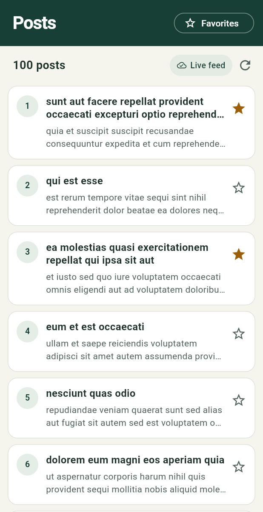
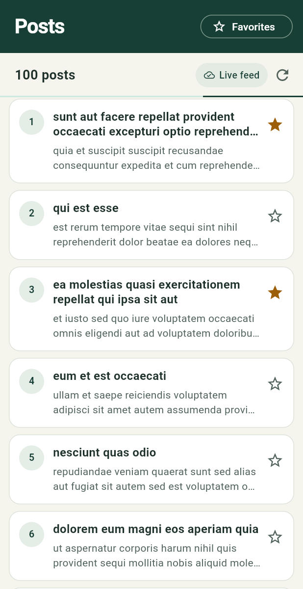
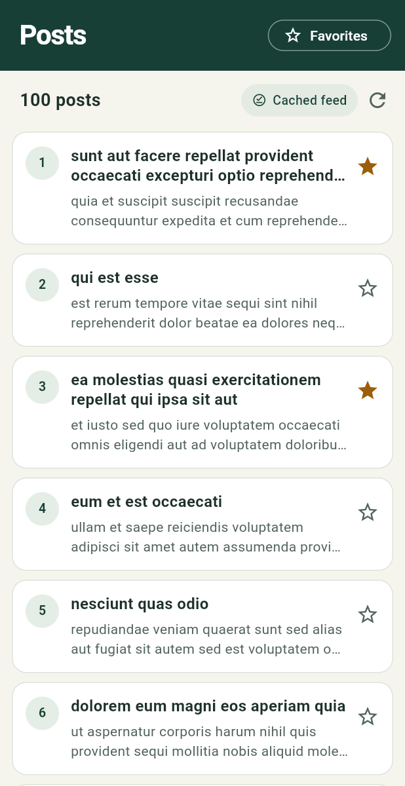
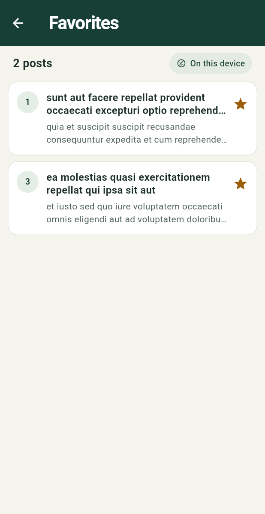
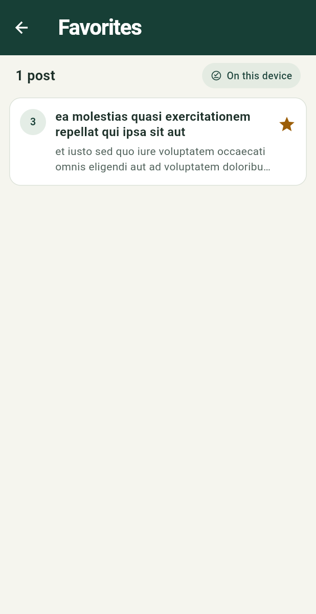
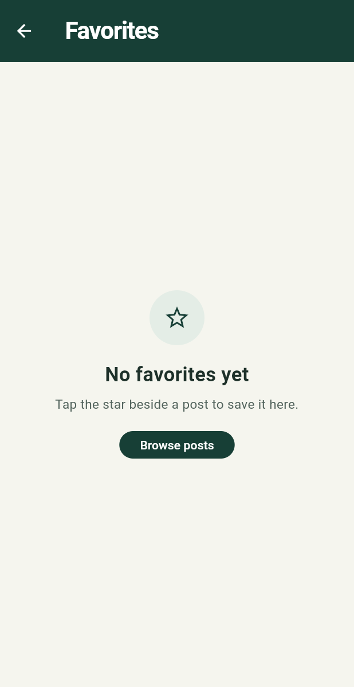
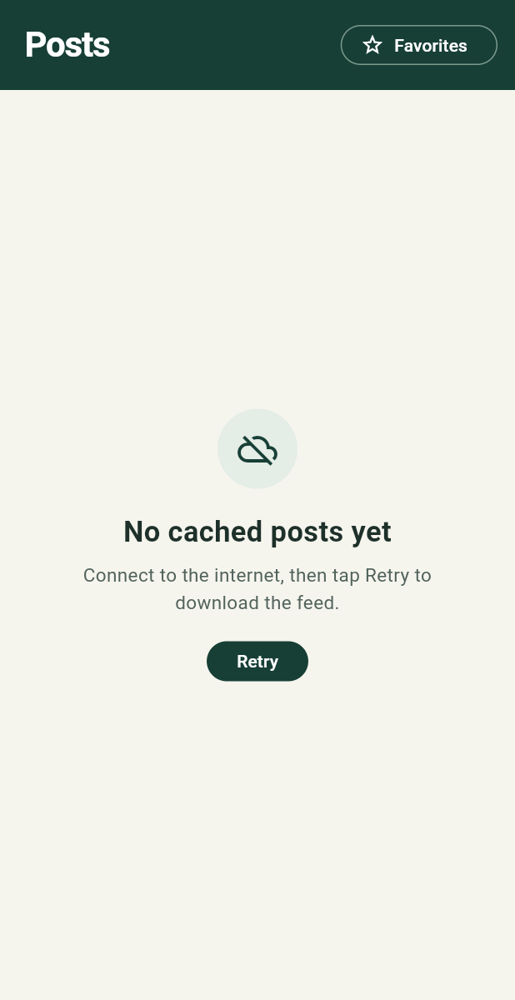

# Offline Posts

A Flutter app for the Section 5 Hive assignment. Read the JSONPlaceholder feed, tap the star beside a post, and open **Favorites** to find it again. Both lists stay available after a successful download, even when the app restarts without an internet connection.

## Run the project

Open the folder containing `pubspec.yaml` in VS Code or a terminal. The project was tested with Flutter **3.47.8** and Dart **3.13.7**. The Hive adapter and dependency lockfile are included.

```sh
flutter pub get
flutter devices
```

On a Mac with Xcode configured, run `flutter run -d macos`. For an Android device or iOS simulator, run `flutter run -d <device-id>` using the ID printed by `flutter devices`. Start the app online once so it can download the feed.

For a quick browser preview, run `flutter run -d chrome`. For a full offline browser restart, build and serve the release app with the commands below.

```sh
flutter build web --release --no-web-resources-cdn
python3 -m http.server 8080 --directory build/web
```

Open **http://localhost:8080** in a normal browser window. Reopen that same address using the same browser profile so Hive can read the saved data. The release build stores the app files on the first visit. The posts and favorites are stored separately in Hive.

## Screenshots

These captures show the running Flutter release app in a mobile-sized browser window. Posts 1 and 3 are used throughout the sequence.

| Load the feed | Add favorites | Open Favorites |
| --- | --- | --- |
|  |  |  |
| The first download returns 100 posts. | Tapping a star updates that card immediately. | The **Favorites** button in the app bar opens the saved list. |

| Refresh the feed | Restart offline | Open Favorites offline |
| --- | --- | --- |
|  |  |  |
| Pull down or use the refresh button. Both stars survive the refresh. | **Cached feed** identifies the 100 posts that Hive restored. | Posts 1 and 3 retain their titles and bodies with the network disabled. |

| Remove a favorite | Remove the last favorite | Start offline with no saved feed |
| --- | --- | --- |
|  |  |  |
| Tapping the star on post 1 leaves post 3 in the list. | **Browse posts** returns to the feed, where the stars are outlined again. | Connect to the internet and tap **Retry** to download the first copy. |

## Reproduce the airplane-mode test

1. On a phone or emulator, launch the installed app online. Wait for **Live feed**.
2. Star posts **1** and **3**, open **Favorites**, and check that both appear. Return to **Posts** and pull down to refresh.
3. Fully close the app. Turn on airplane mode and make sure Wi-Fi is off.
4. Reopen the app from its icon. **Posts** shows **Cached feed**. Open **Favorites** again and check for posts **1** and **3**.
5. Remove a favorite while offline. Return to **Posts** and check that its star is outlined there too.

The browser restart shown above used two separate browser processes. After the online run, the browser's ordinary HTTP cache was cleared, the app's local web server was stopped, and a new process opened the same profile with networking disabled. The API request failed, Hive returned all 100 posts, and both saved favorites could still be removed offline.

## How storage works

| Component | Responsibility |
| --- | --- |
| `lib/main.dart` | Initializes Hive, registers `PostAdapter`, and opens both boxes before showing the app. |
| `lib/models/post_model.dart` | Maps the API fields to a `Post`. Its adapter uses type ID 0 and four stable Hive field indexes. |
| `lib/services/post_service.dart` | Downloads and validates the feed. On success it updates `postsBox` by post ID and removes stale IDs. If the API fails, it returns the last successful download. |
| `lib/services/favorites_service.dart` | Provides `toggleFavorite(Post post)`, `isFavorite(int id)`, and `getFavorites()`. It saves a copy under the post ID because a Hive object instance belongs to one box at a time. |
| `lib/screens/` and `lib/widgets/post_card.dart` | Both screens use the same card. They listen for changes to `favoritesBox` so tapping a star updates both views. |

The feed service only writes to `postsBox`. A favorite stays in `favoritesBox` even if the source later removes the post. The feed displays any saved posts while checking for updates.

## Run the checks

```sh
flutter analyze
flutter test
```

The eight tests cover adding and removing favorites, copying Hive objects, refreshing with stale IDs, reopening both boxes from disk, handling an empty cache, preserving a good cache after an API error, overlapping refresh requests, and updating the screens after a tap or retry.

After changing the model's Hive annotations, regenerate the included adapter with the command below.

```sh
dart run build_runner build --delete-conflicting-outputs
```
