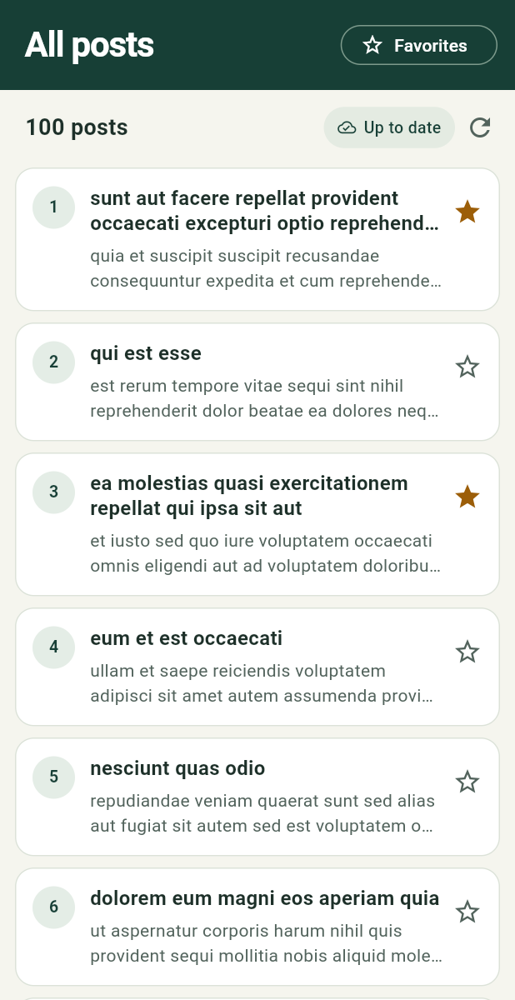
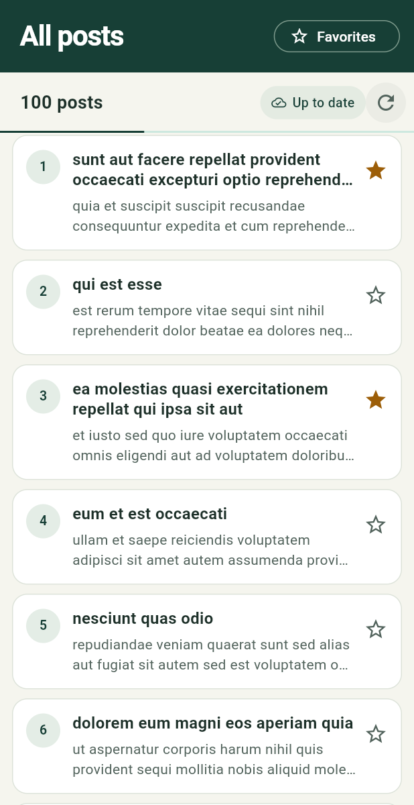
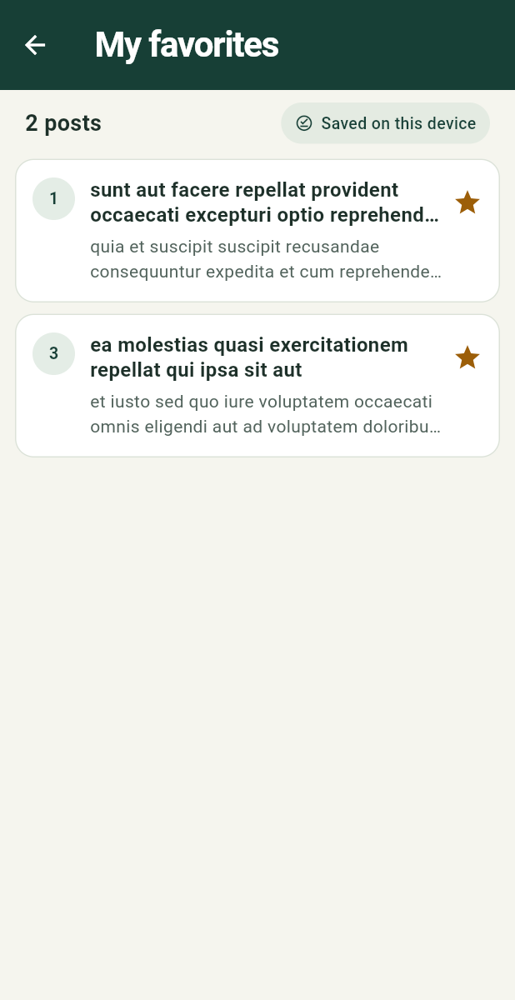
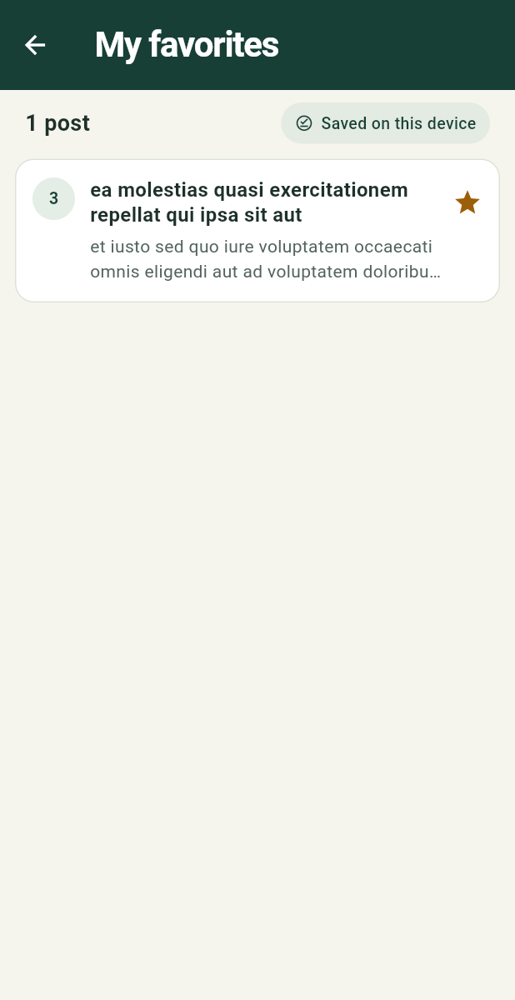
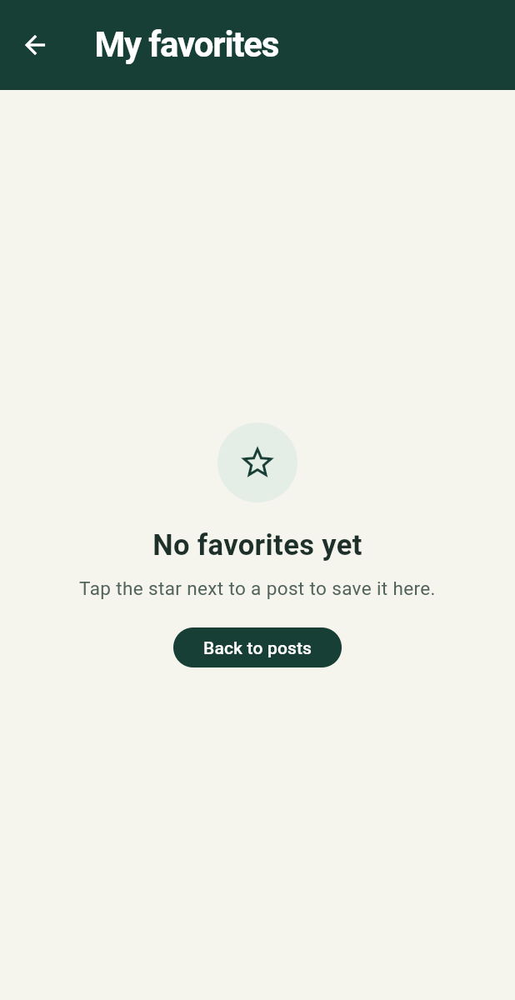
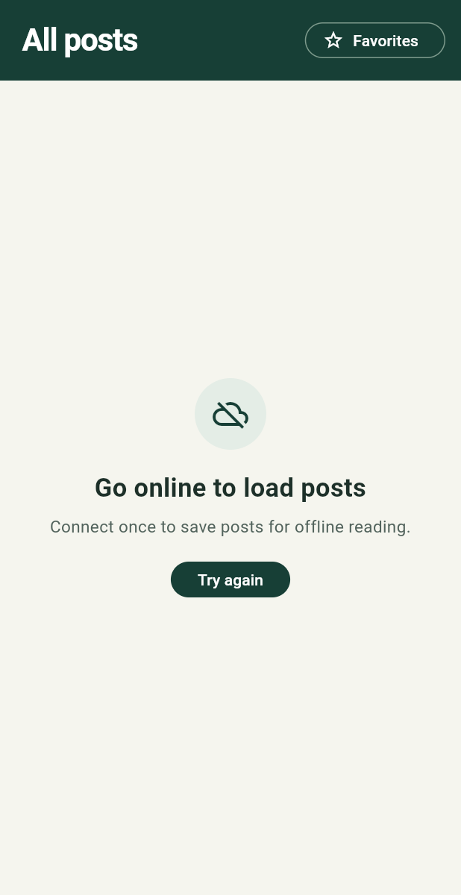

# Post Reader

Post Reader downloads posts from JSONPlaceholder so you can read them offline. Tap the star next to a post to keep it in **My favorites**. This is the Flutter and Hive project for Section 5.

## Run the app

Connect a phone or start a simulator, then run these commands in the project folder.

```sh
flutter pub get
flutter run
```

You can also run `flutter run -d macos` on a Mac or `flutter run -d chrome` for a browser preview. Go online for the first launch so there's a feed to read later.

## Posts and favorites

These screenshots are from the Flutter web app. After the browser was closed and reopened offline, all 100 posts were still there. Posts 1 and 3 were still starred.

| All posts | Star two posts | Open Favorites |
| --- | --- | --- |
|  |  |  |

| Refresh the list | Reopen offline | View favorites offline |
| --- | --- | --- |
|  |  |  |

| Unstar a post | Remove the last favorite | First launch without a connection |
| --- | --- | --- |
|  |  |  |

## Try it offline

1. Open the app online and star two posts. Pull down to refresh. Their stars should stay filled.
2. Close the app, switch on airplane mode with Wi-Fi off, and reopen it. **All posts** shows **Saved copy**.
3. Open **Favorites** and unstar a post. It disappears from the list. Go back to **All posts** to see its outlined star.

To try a full restart in a browser, build the web app and serve it locally.

```sh
flutter build web --release --no-web-resources-cdn
python3 -m http.server 8080 --directory build/web
```

Visit `http://localhost:8080` online first. Use the same address and browser profile when you reopen it offline so the app can find your saved posts.

## How saving works

Hive keeps the last download in `postsBox`. Each starred post gets its own copy in `favoritesBox`, keyed by post ID. Refreshing the feed only updates `postsBox`, so it doesn't erase your favorites.

## Tests

```sh
flutter analyze
flutter test
```
